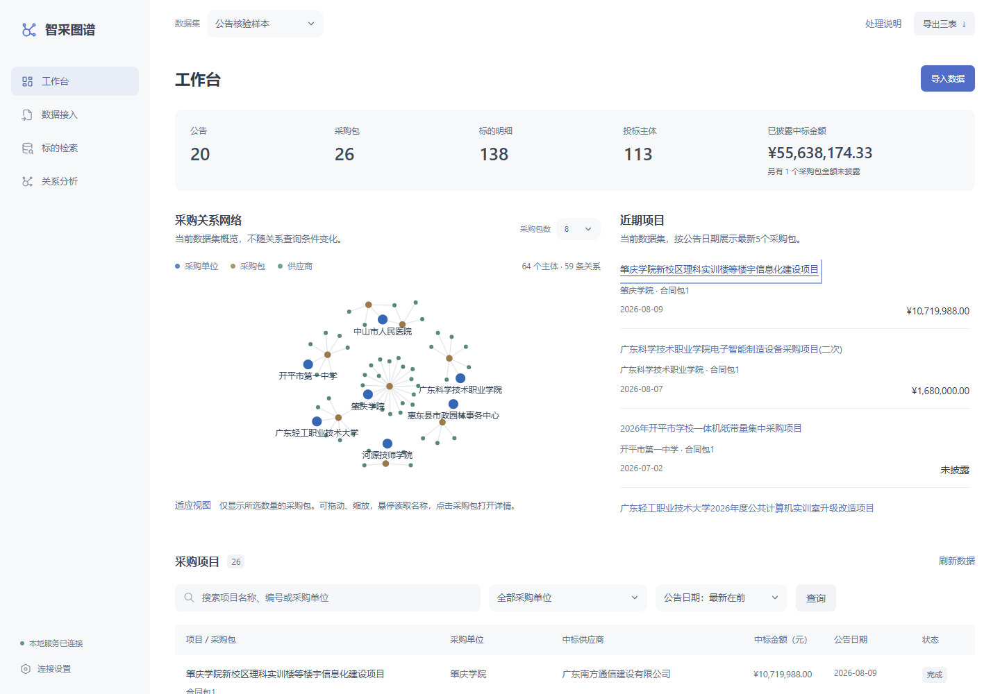

# 智采图谱

政府采购公告与附件的实体提取、采购包关系建模和可视化检索系统。

第一次使用请看[新手操作指南](docs/user-guide.md)，按页面完成样本查询、原文核对、关系分析和Excel下载。



## 功能

- 从公告和附件提取产品名称、品目、品牌、型号、单价、数量、总价，并保留原文证据。
- 按公告、采购包和投标记录组织数据，区分中标、审查通过、审查失败与未知状态。
- 提供合作画像、投标活跃度、供应商竞争、共同采购单位、共同竞标项目五类查询。
- 支持批量上传、解析预检、历史响应回放、处理进度、七字段筛选与比赛三表导出。

前端采用 Vue 3、Vite、ECharts，后端采用 Python、FastAPI、SQLite；可选同步至 Neo4j。

## 启动

需要 Python 3.12 和 Node.js 22.12+。先在项目根目录打开终端，即同时包含 `README.md`、`scripts` 和 `demo` 的文件夹。以下命令使用相对路径，不要求指定盘符或安装目录。

首次安装依赖：

```powershell
.\scripts\run_project.ps1 -Mode Setup
```

日常使用时，第一个终端启动后端：

```powershell
.\scripts\run_project.ps1 -Mode Api
```

在项目根目录另开一个终端启动前端：

```powershell
.\scripts\run_project.ps1 -Mode Web
```

打开 http://127.0.0.1:5173。首次启动会加载20条公告的历史样本；浏览和查询不需要模型Key。历史回放只读取与当前抽取规则匹配的响应；旧缓存不匹配时，需要选择模型抽取重新生成结果。

模型地址、名称、API Key和启用状态可在页面“连接设置”中保存，刷新及重启后保留；已有`.env`配置继续作为初始值。保存不请求模型，Key不回显，私有配置不随Git上传。历史响应回放仅适用于已有缓存的输入，缓存缺失直接失败。API文档位于 http://127.0.0.1:8000/docs。

## 先试一次检索

1. 顶部数据集选择“公告核验样本”，左侧进入“标的检索”。
2. 点击“重置”，清除之前的搜索和筛选条件。
3. 在“规格型号”填写 **MES3200**，只填型号本身，再点击“检索”。
4. 应出现1条“智慧工厂管理系统”，品牌科瑞特、数量1、单价及总价均为358,000元；点击“查看原文”核对出处。

型号按完整值匹配，提交时会清理首尾的空格和反引号；搜索框也可以按采购单位或中标供应商检索。所有查询只读取当前数据集，导出三表则针对整个当前数据集。

导出文件按用途命名：

| 下载入口 | 文件名 |
|---|---|
| 顶部“导出三表” | `procurement-tables.xlsx` |
| 处理记录“下载此批三表” | `procurement-batch-tables.xlsx` |
| 层级核验“下载当前数据集的明细三表” | `procurement-detail-tables.xlsx` |

## 测试

```powershell
.\scripts\run_project.ps1 -Mode Test
.\demo\procurement\.venv\Scripts\python.exe .\scripts\audit_publish.py
```

浏览器回归的安装和运行方式见[开发说明](docs/development.md)。测试使用隔离数据库，不清空业务数据。

## 目录

```text
demo/procurement/
  backend/          Python服务和测试
  frontend/         Vue界面、依赖清单与锁文件
  data/demo/        20条公告、历史响应和演示清单
  docker-compose.yml
data/
  official-benchmark/  官方输入、输出格式与索引
  reference/           局部验证参考
scripts/            启动、数据准备、回归及发布检查
  materials/        可选的材料制作脚本
docs/               使用、架构、API、数据和验证说明
  materials/        材料制作配套文件
tools/              本地Office和7z解析工具
config/             模型资源声明模板与本机私有模型设置
training/           可选LoRA训练入口与独立依赖
deliverables/       本地交付材料，不随源码提交
results/            本地验证结果，保留在本机
.cache/             本地缓存与运行日志
```

`.venv`、`node_modules`和解析工具保留在本机。`.env`、私有模型配置、数据库、上传文件、全量输入、缓存及生成材料已通过`.gitignore`排除。`demo/procurement/data/demo/cache`中的内置历史响应是无Key的演示资源，随源码保留，供首次启动和离线回放使用。

## 数据与验证范围

示例数据包含20条公告、26个采购包、138条商品和123条投标记录。商品参考覆盖79行，未标注的额外明细不计入局部准确率。参考由程序生成并核对来源，仍待独立人工复核。

本地已验证七字段筛选、五场景、来源查看及三表格式。20篇含附件回放有10篇部分完成；全量准确率、赛事标准模型和目标平台性能尚未完成验收。完整说明见[验证与限制](docs/validation.md)。

2026-10-18 收尾版本 2.4.1 已更新公网：修复供应商名录中的匿名编号与占位名称，全量数据标签不再带日期；1,038 篇公告、2,214 个采购包、21,599 条标的来源记录及三表导出已核验。五场景本次公网平均完整渲染耗时约 1.98 秒，模型资源声明和正式准确率仍未验收。详见[收尾与交接记录](docs/verification/competition-closeout-20261018.md)。

## 文档

- [新手操作指南](docs/user-guide.md)
- [模型配置](docs/model-settings.md)
- [功能复查与人工检查](docs/manual-verification.md)
- [系统架构](docs/architecture.md)
- [API接口](docs/api.md)
- [数据说明](docs/data.md)
- [开发与部署](docs/development.md)
- [服务器部署与评审操作](docs/deployment.md)
- [Neo4j、RAG与LoRA](docs/advanced-features.md)
- [验证与限制](docs/validation.md)
- [赛题原文](docs/requirements/task-5.md)
- [第三方组件说明](THIRD_PARTY_NOTICES.md)
