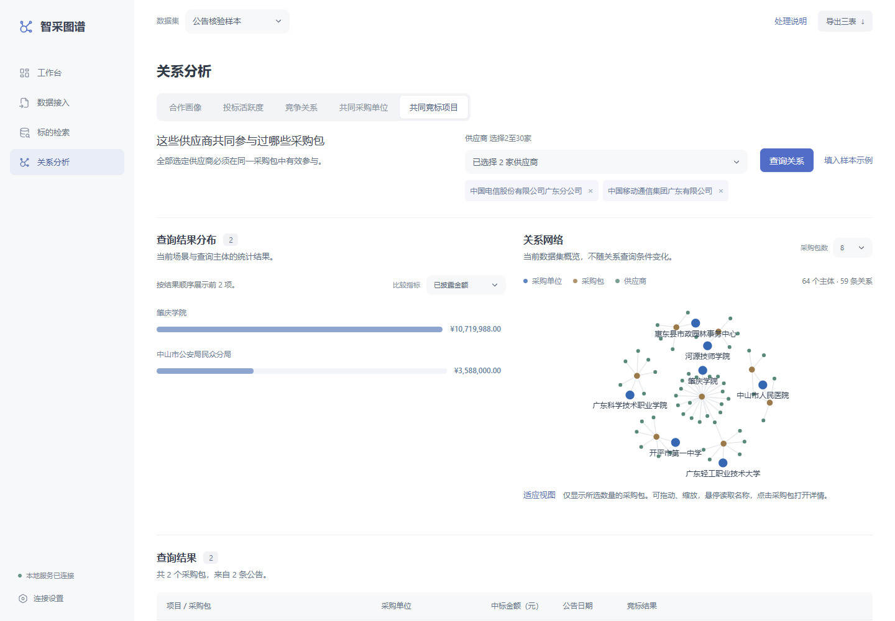

# 新手操作指南

这个项目用来阅读政府采购公告：把长公告和附件中的“买了什么、谁买的、谁中标、谁参与投标”整理出来，再让你搜索、查看关系和下载Excel。

第一次使用，先跟着下面的样本练习操作。已有20篇公告的结果，不需要先买模型服务，也不需要先上传文件。本文对应2.4.0界面。

## 一、打开页面，选对数据

1. 打开 [项目页面](http://127.0.0.1:5173/#/overview)。如果页面打不开，先看本文后面的“以后怎样自己启动”。
2. 看左下角，出现“本地服务已连接”说明页面已连接到处理数据的程序。
3. 在页面顶部找到“数据集”下拉框，选择 **公告核验样本**。
4. 左侧点击“工作台”。顶部应显示 **20篇公告、26个采购包、138条标的明细**。


先认识三个词：**公告**是一篇采购通知；**采购包**是这次采购中单独招标的一组内容；**标的**就是采购的商品或服务。一篇公告可以有几个采购包，一个包里又可以有很多商品，所以三个数量不同。

页面上的四个入口分别做这些事：

| 入口 | 你可以做什么 |
|---|---|
| 工作台 | 查看采购关系网络和近期项目，在完整项目列表中搜索、筛选并打开详情 |
| 数据接入 | 上传新文件，查看处理进度 |
| 标的检索 | 按商品名称、品牌、型号、价格等找具体商品 |
| 关系分析 | 查询采购单位与供应商之间的合作和竞争关系 |

“数据集”可以理解为不同的资料夹。你在上面选哪个资料夹，下面就查哪个资料夹，上传结果也存进去。先一直选“公告核验样本”；“官方基准数据”为空时，是尚未导入结果，不表示程序坏了。“合成演示数据”是构造案例，不能当作真实公告结果。

## 二、找一个采购项目，看看它买了什么

这一步的目标：找到肇庆学院的采购项目，打开详细信息。

1. 在“工作台”搜索框输入 **肇庆学院**。
2. 点击旁边的“查询”。
3. 点击结果中蓝色的项目名称“肇庆学院新校区理科实训楼等楼宇信息化建设项目”。
4. 右侧会出现“采购包详情”，上面列出采购单位、中标供应商和中标金额。
5. 点击“标的明细”，看买了什么、数量和价格；点击“竞标结果”，看有哪些公司参与、审查状态和得分。
6. 看完后点击右上角“关闭”，回到列表。


这个样本中，采购单位是肇庆学院，中标供应商是广东南方通信建设有限公司，中标金额为 **10,719,988元**。这些值可以用来确认你打开的是同一个样本。

想恢复全部项目：清空搜索框，再点一次“查询”。

## 三、找一个具体商品，并核对出处

这一步的目标：根据型号找到一件商品，知道表格里的信息从哪里来。

1. 先确认顶部数据集是 **公告核验样本**，左侧点击“标的检索”。
2. 点击“重置”，清除之前留下的搜索和筛选条件。
3. 在 **规格型号** 输入框只填写 **MES3200** 这7个字母和数字，不要把示例两侧的格式符号一起复制。
4. 点击“检索”。应看到“智慧工厂管理系统”，品牌是科瑞特，数量是1，单价和总价均为358,000元。
5. 点击这一行最右侧的“查看原文”。
6. 右侧出现“标的来源”，其中有原文证据、来源文件和定位信息。用它们对照原始公告，检查名称、型号、金额是不是同一件商品。
7. 关闭来源面板，点击“重置”，恢复全部商品。

型号需完整匹配。提交时会清理首尾的空格和反引号，并在输入框中显示清理后的型号。结果上方会标明当前数据集；其他数据集未必有这条样本，不能只看输入内容相同就期待相同结果。


想按价格找商品：点击“金额与数量筛选”，填写单价、数量或总价的范围，再点“检索”。页面金额单位是 **元**，例如30万元要填 `300000`。不需要的条件保持空白；下限不能大于上限。

“未披露”表示当前记录没有该信息，不等于价格为0或公司没有参与。来源面板提供核查线索，最终仍要以原始公告、附件为准。

### “层级核验”要怎么用

进入“工作台”，打开一个采购包，再点击详情里的“层级核验”。它处理的是这类情况：公告写“设备一批，共10万元”，附件又逐条列出这批设备；如果把两边都相加，就可能重复统计。

- 出现“包含关系已确认”：展开“核验依据”，查看系统确认摘要与明细属于同一组内容的依据；可以分别打开摘要、明细原文。
- 出现“保留全部原文行”：证据还不足，系统保留全部行，等待核查。
- 出现“暂未发现可核验的摘要与明细关联”：当前没有足够证据建立这种关系。内置20篇正文样本出现这个提示是正常的。

这里是辅助核查页面，暂时不能直接修改字段或点击人工确认。默认导出保留原文记录；“下载当前数据集的明细三表”只会折叠已经确认的摘要，并导出整个当前数据集。

## 四、查供应商之间的合作和竞争

先做一次最简单的查询：

1. 左侧点击“关系分析”。
2. 选择“合作画像”。
3. 点击“填入样本示例”，采购单位会填成 **香港城市大学(东莞)**。
4. 再点击“查询关系”。只点“填入样本示例”还不会查询。
5. 下方会出现合作供应商、次数、金额等结果。这个样本有4家中标供应商。
6. 查询图表直接展示，完整明细表格同时保留在下方。可切换图表的频次、已披露金额及结果分组。
7. 关系网络默认展示在图表旁边，窄屏时排列在图表与明细表格之间。它展示当前数据集的关系概览，不随本次查询主体变化；可调整采购包数、拖动和缩放，点击“适应视图”重新显示完整网络，点击采购包打开详情。



其他场景也按“选场景 → 选单位或公司 → 查询关系”的顺序操作：

| 场景 | 用一句话理解 | 需要选择什么 |
|---|---|---|
| 合作画像 | 这家采购单位的订单主要给了谁 | 一家采购单位 |
| 投标活跃度 | 哪些公司经常来参加这家单位的采购 | 一家采购单位 |
| 竞争关系 | 这家公司经常和哪些公司同场竞标 | 一家供应商 |
| 共同采购单位 | 选中的几家公司都给哪些单位供过货 | 至少两家供应商 |
| 共同竞标项目 | 选中的几家公司一起参加过哪些采购包 | 至少两家供应商 |

第一次可以每个场景都点“填入样本示例”再查询。后两项需要至少选两家公司，选一家时查询按钮不会启用。这里分析已有数据，不调用模型，也不产生新的模型费用。

## 五、下载查询所用的数据

1. 先看顶部“数据集”，确认是你想下载的那一份。
2. 点击右上角 **导出三表**。
3. 打开下载的 `procurement-tables.xlsx`，里面有三个工作表：

| 工作表 | 内容 |
|---|---|
| 总表 | 每个采购包的项目、单位、中标供应商和金额 |
| 标的表 | 商品或服务的名称、品目、品牌、型号、数量和价格 |
| 投标人表 | 参与公司、审查情况、报价和得分等 |

页面金额显示 **元**，比赛Excel中的金额按 **万元** 输出。例如页面358,000元，在表中是35.8万元。

顶部“导出三表”下载的是 **整个当前数据集**，不跟随商品搜索条件缩小范围。如果只要某次上传的结果，在“数据接入”的“处理记录”中选择那次任务，再点击“下载此批三表”，文件名为 `procurement-batch-tables.xlsx`。层级核验中的明细视图下载为 `procurement-detail-tables.xlsx`。“处理说明”下载的是JSON说明文件，用来记录告警、失败原因等，不是另一张Excel。

到这里，你已经完成了：打开样本 → 找项目 → 查商品 → 看证据 → 查关系 → 下载结果。

## 六、使用内置样本与历史响应回放

已有样本可以直接浏览，无需模型Key。历史回放只适用于当前规则下已保存的模型回答；规则更新后，随项目附带的旧缓存可能不再匹配。需要按新规则重新生成结果时，下载样本公告，按下一节配置模型并选择“模型抽取”。

1. 顶部数据集切换为 **工作数据**，后续结果会写入这里。里面可能已有记录，不要求是空的。
2. 左侧点击“数据接入”。
3. 点击上方的 **核验样本** 标签。
4. 已有与当前规则匹配的缓存时，点击“回放核验样本”；没有匹配缓存时，下载公告并选择“模型抽取”。
5. 在下方“处理记录”中等任务结束，查看成功、待核对、失败数量。
6. 点击“下载此批三表”，查看这次任务的结果。


“回放”读取与当前输入和规则匹配的已保存模型回答，不向模型服务发请求，也不会退回旧规则。没有匹配响应时会明确报告失败。“下载样本公告”可以拿到这20篇原始正文，用来自己查看或重新抽取。

## 七、处理自己的文件前，配置模型

如果只浏览已有结果，或者做解析预检、样本回放，可以跳过这一节。要从新公告中生成新结果，才需要模型服务。

1. 点击左下角 **连接设置**。
2. 找到上半部分的“模型服务”。
3. 填写下面三项：

| 输入项 | 怎么填 |
|---|---|
| 服务地址 | 模型提供商给你的基础地址。例如DeepSeek的 `https://api.deepseek.com`；已有自动填写值时可沿用 |
| 模型名称 | 服务商提供的模型标识，不是随便起的名字；已有配置时可先保留 |
| API Key | 从模型服务商获得的密钥；如果旁边已经写“已配置”，可以留空 |

4. 勾选“启用模型抽取”，点击 **保存模型配置**。
5. 出现“配置已保存，新任务立即生效。”后，关闭面板。


**保存一次后会保留。** 刷新页面或重启服务不用重新填写。Key输入框重新打开后是空的，这是为了不把密钥显示出来；看旁边的“已配置”即可。想换Key时填入新的再保存，留空则保留原Key。

下面的“服务访问令牌”是管理员为这个系统设置的访问密码，与模型Key不同。本机没有启用访问保护时不用填写。如果管理员给了你访问令牌，先在这里填好并点击“保存并连接”，再管理模型配置。

保存不请求模型，也不能证明余额或模型连接正常。Key保存在运行项目的电脑或服务器里，不随GitHub上传；换电脑重新部署时需要另行配置。

## 八、上传自己的公告，生成新结果

先弄清“处理方式”再点击开始：

| 处理方式 | 做什么 | 请求模型吗 | 会生成新的商品和关系结果吗 |
|---|---|---|---|
| 解析预检 | 检查文件能否读取、有哪些正文和附件 | 不会 | 不会 |
| 历史响应回放 | 使用与输入匹配的已保存模型回答 | 不会 | 会，内容来自已有回答；没有匹配记录就失败 |
| 模型抽取 | 读取文件，再调用你配置的模型整理结果 | 可能产生费用 | 会，完整程度取决于输入及处理结果 |

建议先用一篇公告练习：

1. 顶部选择 **工作数据**。
2. 左侧点击“数据接入”，选择“上传文件”。
3. “处理方式”先选择 **解析预检**。
4. 点击“选择文件”，选择一篇公告和它对应的附件，也可以拖入文件。支持的类型显示在上传区域，包括HTML、PDF、Office、图片和压缩包。
5. 点击“开始处理”，在下方查看进度和处理说明。“预检通过”只表示文件可以读取，不会让商品数量增加。
6. 确认模型配置已保存后，把处理方式改成 **模型抽取**。检查选中的文件，只保留这次要处理的少量文件，再点“开始处理”。这一步可能产生模型费用。
7. 等任务结束，查看每篇公告的状态；有“待核对”或“失败”时，先看对应处理说明。
8. 回“工作台”“标的检索”查看新结果，记得顶部仍选择“工作数据”。
9. 回“数据接入”，点击“下载此批三表”。


“本地基准数据”读取的是运行后端那台电脑的官方数据目录，适合已经准备好官方文件的人。第一次使用走“上传文件”即可。模型抽取任务的“重新处理此批”可能继续请求模型；先查明失败原因再重试。

## 九、以后怎样自己启动

**如果页面现在已经能打开，不要再重复启动。** 以下是以后关机、停止服务或换电脑安装时的步骤。

### 第一次安装，才做这一步

先安装项目要求的Python 3.12+和Node.js 22.12+。在项目根目录打开PowerShell，再安装依赖。项目根目录就是同时包含 `README.md`、`scripts` 和 `demo` 的文件夹。

Windows可以先在文件资源管理器中打开这个文件夹，在地址栏输入 `powershell` 并按回车，终端就会从这里打开。

```powershell
.\scripts\run_project.ps1 -Mode Setup
```

以上命令使用项目内的相对路径，不要求项目放在指定盘符或文件夹。安装完成后，日常启动不需要重复Setup。旧版Office、RAR和扫描件还需要额外解析工具，准备方法见[部署说明](deployment.md)。

### 每次使用，打开两个PowerShell窗口

两个窗口都在项目根目录打开。第一个窗口启动后端，它负责存数据和处理文件：

```powershell
.\scripts\run_project.ps1 -Mode Api
```

第二个窗口启动前端，它提供你看到的页面：

```powershell
.\scripts\run_project.ps1 -Mode Web
```

两个窗口保持打开，再访问 [http://127.0.0.1:5173](http://127.0.0.1:5173)。不要求你看懂终端日志；只要没有报错，页面左下角显示已连接即可。

自己从这两个窗口启动时，要停止就分别按 `Ctrl+C`。停止服务不会删除已经保存的数据库和模型配置。重启服务是先停止，再执行对应启动命令；不用重新安装依赖。

## 十、遇到这些情况怎么办

| 你看到的情况 | 先这样处理 |
|---|---|
| 页面打不开 | 确认前后端都在运行，打开的是5173地址；8000是后端接口 |
| 页面能打开，但“服务连接失败” | 检查后端窗口是否报错；重新启动后端，再刷新页面 |
| 显示401或需要访问令牌 | 打开“连接设置”，在“服务访问令牌”填管理员给的系统令牌，再点“保存并连接”；不要填模型Key |
| 页面没有数据或搜索不到 | 先看顶部数据集是否正确，再点“重置”或清空搜索条件 |
| 找不到“填入样本示例” | 切换回“公告核验样本”；其他数据集不一定包含示例公司 |
| 模型Key输入框是空的 | 看旁边是否写“已配置”；写了就不用重新填 |
| “模型抽取”不能选 | 在“连接设置”勾选启用模型抽取并保存；配置损坏时按提示重新填写 |
| 预检完成，但没增加商品 | 这是预检的正常结果；需要新抽取结果时才选择“模型抽取” |
| 历史响应回放提示没有缓存 | 当前文件或规则没有匹配的已保存回答；可直接浏览已有样本，需要新结果时选择模型抽取 |
| 导出的商品比搜索结果多 | 顶部导出针对整个数据集，搜索只改变页面列表；单次任务请用“下载此批三表” |
| 任务显示待核对或部分失败 | 展开处理说明，查看逐公告原因，不要只看进度条是否到100% |

内置样本用于学习和演示，当前结果仍有待人工复核的信息。需要逐项检查功能是否正确时，再看[人工检查指南](manual-verification.md)；模型保存位置等细节见[模型配置说明](model-settings.md)。
