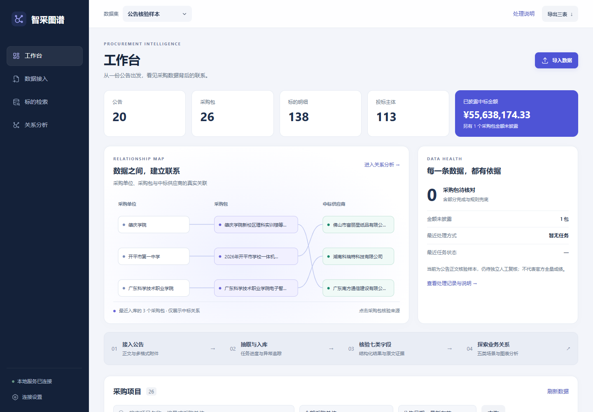
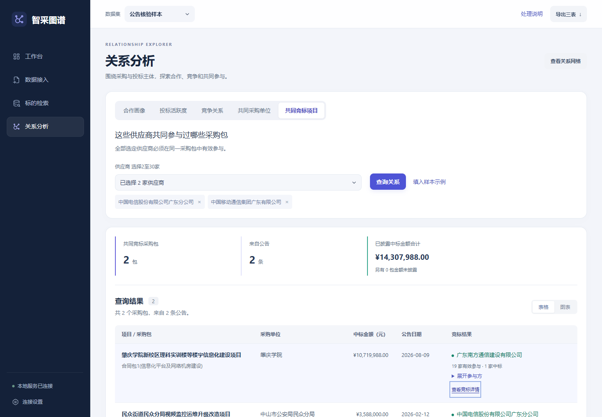
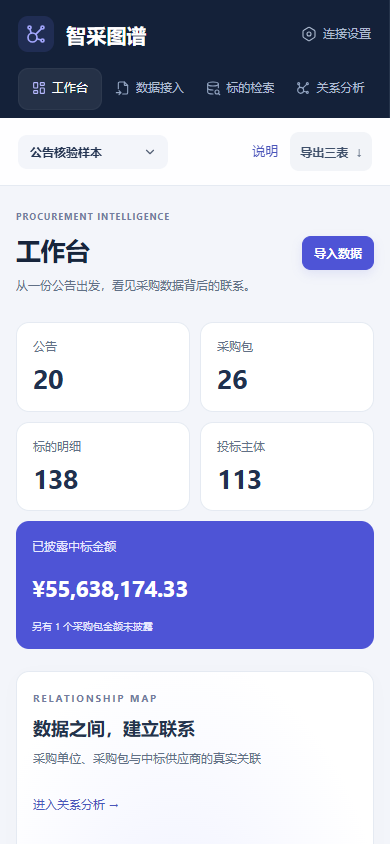

# 工作台视觉与信息呈现调整

## 改动

- 深墨蓝导航、浅色工作区、靛蓝主操作与青绿关系标记；统一标题、卡片、表格和状态层级。
- 工作台增加真实采购关系概览、当前数据集质量提示和四步操作入口。关系概览通过项目列表接口展示最近入库的三个采购包及其中标关系，支持键盘打开采购包；完整 ECharts 网络仍按需加载。
- 五类关系查询增加结果摘要；共同竞标结果默认展示中标主体和有效参与数量，完整名单按需展开。
- 原文侧栏展示七类字段，点选字段后按原值进行文字匹配高亮；关联来源与计算补充值改为可读条目。
- 压缩上传区空白，适配窄屏表格和卡片；修复手机端金额标签、金额与说明的重叠。

## 数据口径与边界

待核对数为 partial 与 fallback 采购包数之和。金额缺失和任务状态均来自当前数据集；不将模型置信度、字段完整程度或历史回放耗时宣称为抽取准确率或模型处理性能。

首页关系概览是当前数据集的有限预览，不是全量关系图，也不代表当前关系分析查询的结果。高亮仅为当前原文片段中的文字匹配，不是字段定位或抽取正确性的证明；数字格式不同时可能无法高亮，仍可人工核对。未新增自然语言问答，也未虚构后端未提供的逐阶段进度。

## 验证

- `npm --prefix demo/procurement/frontend run build`
- `node scripts/test_query_network.mjs`：验证关系来源、结果分组、节点限量与唯一性；竞争关系图分别使用 Top 5 或全部参与方，保持与当前结果分组一致。
- `node scripts/verify_frontend.mjs --production`：21 项通过。
- `node scripts/verify_frontend_edgecases.mjs`：9 项通过。
- `node scripts/verify_item_hierarchy.mjs`：5 项通过；保留程序定位原文、层级核验及明细导出。
- `node scripts/verify_model_settings.mjs`：5 项通过；保留配置持久化与凭据隐藏。
- `python scripts/audit_publish.py`：发布检查通过。

浏览器验证使用独立数据库和随项目提供的样本，禁止模型 HTTP 调用。新增检查覆盖真实概览与键盘打开详情、证据字段切换、摘要金额、名单折叠、手机金额排版，以及延迟响应隔离和概览失败重试。现有筛选、五场景、导出、项目排序和减少动态效果检查保留。

构建仍有原有 ECharts 分包大于 500 kB 的提示；图引擎保留动态加载，首页 SVG 概览不下载图引擎。

## 合并范围

视觉覆盖集中于新增 `frontend/src/intelligence.css`，新增展示组件与现有页面作必要连接。后端新增只读 `/api/graph/overview` 接口，提供完整企业名录和有效建模关系，详见[关系总览口径](relationship-overview.md)。数据库结构、抽取流程、模型配置、依赖及锁文件未因 UI 调整而改动。已与字段修复及性能提升版本一起验证；更新后需要重启后端并重新构建前端。合并前如 main 有新提交，请先同步并复验；本说明不保证未来并行修改不会产生冲突。

## 页面预览

